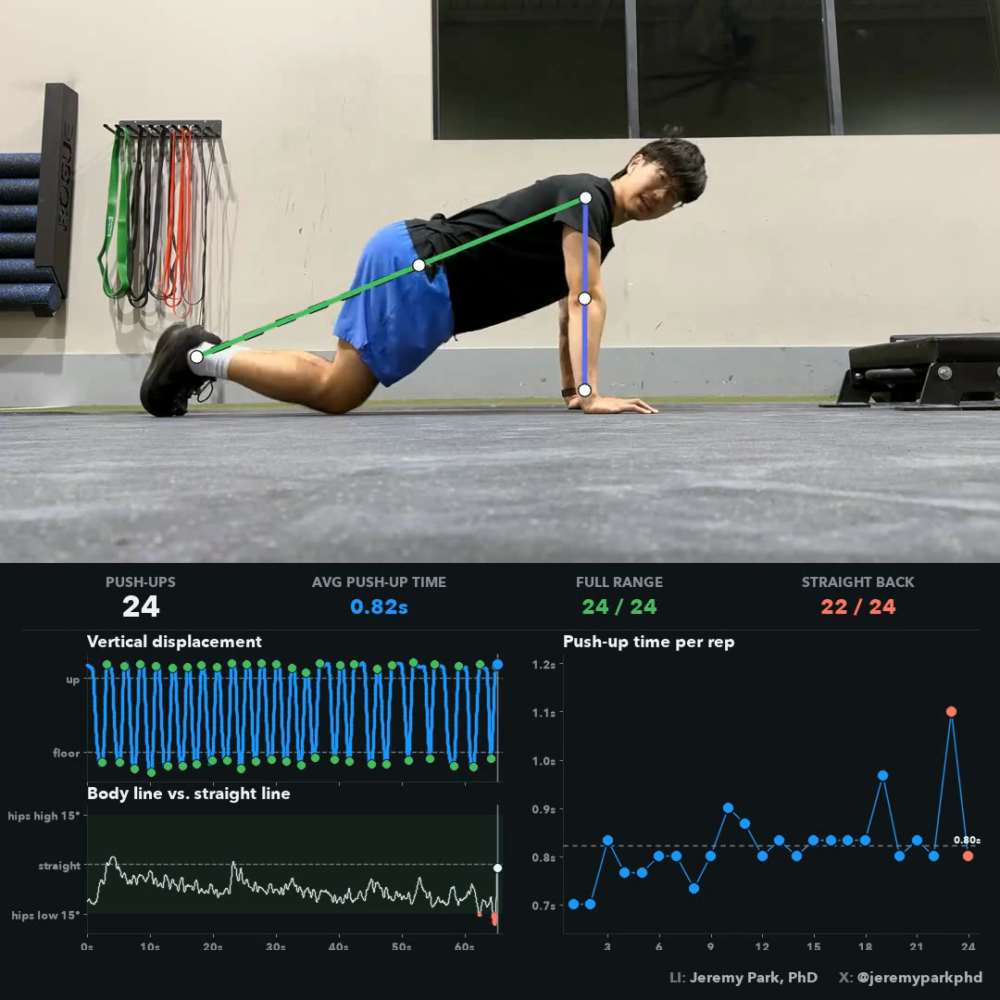

# push_ups

Counts push-ups from a side-on clip and times the **concentric** (the push up) of
every rep. Each rep is also checked for **full range of motion** (chest down to the
floor, then all the way back up) and a **straight back** (hips neither dropping
too low nor rising too high).
Pose runs on
[`vitpose-plus-large`](https://vlm.run/gateway/models/usyd-community-vitpose-plus-large)
through the [VLM Run Gateway](https://www.vlm.run/gateway), so there are no
weights to download. How it works: [how-it-works.md](how-it-works.md).

Built for a **landscape** clip, so the video sits on top with the panel
underneath at the same width, unlike the portrait pull-up and chin-up demos.
The output is a 1080×1080 square (`EXPORT_SQUARE` in [`config.py`](config.py)).
The panel has the live tallies, vertical displacement and the body line over
time, and a dot per rep for the push-up time (the concentric).



## Run it

1. **Get an API key** at [app.vlm.run/sign-in](https://app.vlm.run/sign-in).

2. **Set it** in a `.env` at the repo root:

   ```bash
   cp ../.env.example ../.env
   # paste your key after VLMRUN_API_KEY=
   ```

3. **Create the conda environment:**

   ```bash
   conda env create -f environment.yml
   conda activate push_ups
   ```

4. **Add push-up clips** to `data/input/`, filmed side-on and roughly level
   with the floor, with the whole body in shot.

5. **Run it** from this directory:

   ```bash
   python main.py                                   # every clip in data/input/
   python main.py data/input/my_set.mov             # just this one
   python main.py --li "Your Name" --x @yourhandle  # with your credit in the corner
   ```

   Flags override their [`config.py`](config.py) value for that run only:

   | flag | what it sets |
   |---|---|
   | `CLIP` or `DIR` | clips, or folders of clips, to run (`INPUT`) |
   | `--down 0.40` | how close the shoulder must get to the floor, in arm lengths above the wrist |
   | `--up 0.90` | share of the plank height the shoulder must get back to |
   | `--back-tolerance 15` | degrees the hips may drop below or rise above a straight line |
   | `--metric moving` | what the concentric time measures: `moving` or `ascent` |
   | `--side right` | which side of the body to measure (default: the one facing the camera) |
   | `--height 1080` | the output's height in px (a 1080×1080 square by default), or `full`; no new model call |
   | `--trim 5` | only the first 5 s of each clip, for a quick test |
   | `--fresh` | ignore cached poses and call the model again |
   | `--li` `--x` `--ig` / `--no-credit` | the credit in the panel's corner |

   `python main.py -h` lists them. Everything else stays in `config.py`.

## Output

One timestamped directory per clip under `data/output/`:

```
20261016-010000/
├── <clip>_push_ups.mp4   # overlay on top, live panel below
├── plots.png             # shoulder height with every rep's phases and cutoffs, the
│                         # elbow angle beside it, body line, and every rep's push-up time
├── <clip>_summary.csv    # one row per rep: grades, phase times, heights, elbow angles
├── <clip>_frames.csv     # one row per frame: shoulder height, elbow angle, body line,
│                         # and the rep and phase (down, pause, push-up) it falls in
├── reps.json             # per-rep timings and grades, plus every per-frame series
├── summary.txt           # the rep report
└── run.json              # config, provenance, cost
```

Gateway replies are cached in `data/cache/`, so re-grading a clip against new
thresholds costs nothing, and `data/` is gitignored. `run.json` records what
each run cost.

## License

[Apache-2.0](../LICENSE).
